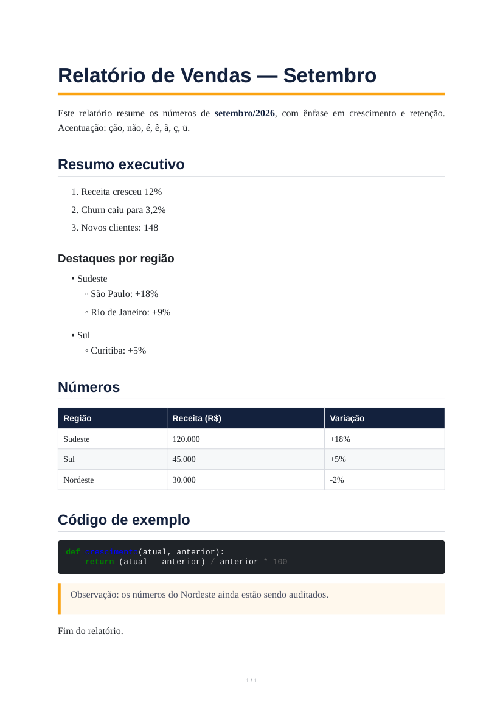

# MDconverter

Conversor **local e offline** entre documentos e Markdown, feito para economizar tokens em LLMs:

- **Para a LLM:** envie `.md` em vez de PDF/Word/Excel. O texto fica limpo e consome muito menos tokens.
- **Para pessoas:** peça à LLM para gerar o `.md` e converta para um **PDF bonito** localmente, em vez de pedir o PDF direto.

Nada sai da sua máquina: sem nuvem, sem API, sem conta.



## Como funciona

Cada ferramenta é uma pasta. **Solte os arquivos na raiz da pasta, rode o conversor, e o resultado aparece na subpasta de saída.** O arquivo original também é movido para lá, deixando a raiz limpa para o próximo lote.

| Pasta | Entrada | Saída (na subpasta) |
|---|---|---|
| `MDtoPDF/` | `.md` | PDF com layout cuidado → `PDFs/` |
| `PDFtoMD/` | `.pdf` | 1 `.md` por PDF → `MDs/` |
| `allPDFtoMD/` | vários `.pdf` | **1 único `.md`** com todos juntos → `MDs/` |
| `ALLtoMD/` | `.pdf` `.docx` `.xlsx` `.csv` `.html` `.txt` `.rtf` | 1 `.md` por arquivo → `MDs/` |

Em vez de rodar cada pasta, o **`watch_all`** fica aberto na raiz, observa as quatro pastas e converte sozinho qualquer arquivo novo.

## Instalação

Requer **Python 3.10+**.

- **Windows:** dê dois cliques em `install.bat`
- **Linux/Mac:** `./install.sh`

(Ou manualmente: `pip install -r requirements.txt`.)

## Uso

Dentro de qualquer pasta de conversão, dê dois cliques em `run.bat` (Windows) ou rode `./run.sh` (Linux/Mac). Também funciona com `python <pasta>/convert.py`.

Para o monitor único:

```bash
python watch_all.py               # fica rodando, checa a cada 3s (Ctrl+C para parar)
python watch_all.py --once        # uma única passada e sai
python watch_all.py --interval 10 # muda o intervalo
```

No Windows, `watch_all.bat`; no Linux/Mac, `./watch_all.sh`.

Na pasta [`exemplos/`](exemplos/) há arquivos prontos para testar (Markdown, Word e Excel), inclusive o PDF gerado da imagem acima.

### Detalhes por ferramenta

**MDtoPDF** — Markdown completo: títulos, listas (inclusive aninhadas com 2 espaços), tabelas, blocos de código com realce de sintaxe, citações, links e numeração de página.

**PDFtoMD / ALLtoMD (PDF)** — títulos (por tamanho de fonte), listas com marcador e numeradas (com aninhamento), tabelas na posição original, blocos de código com indentação e remoção de número de página/rodapé.

**allPDFtoMD** — cada PDF vira uma seção `## nome-do-arquivo` dentro de um `combinado_<data>_<hora>.md`, em ordem alfabética.

**ALLtoMD** — `.docx` (títulos, listas, tabelas), `.xlsx` (cada aba vira uma tabela), `.csv`, `.html`, `.txt` e `.rtf`.

Se um arquivo falha (corrompido, por exemplo), só ele é reportado e fica na raiz; o restante do lote segue normalmente.

## Observações importantes

**PDF no Windows:** o motor principal (WeasyPrint) depende de bibliotecas gráficas (GTK) que normalmente **não** estão instaladas no Windows. Sem elas, o programa usa **automaticamente** um motor alternativo (`xhtml2pdf`, puro Python). O PDF sai com o mesmo estilo, só sem a numeração de página. Para ter o layout completo, instale o [GTK runtime](https://weasyprint.readthedocs.io/en/stable/first_steps.html#windows).

**Executável sem Python (opcional):**

```bash
pip install pyinstaller
python build_executables.py
```

Gera um executável em cada pasta e o `watch_all` na raiz. Precisa ser executado no mesmo sistema operacional de destino.

## Limitações conhecidas

PDF → Markdown é heurístico (tamanho de fonte, posição, fonte monoespaçada):

- Listas só são detectadas se o PDF embute o caractere do marcador (`•`, `-`, `◦`, números). Alguns geradores desenham o marcador como gráfico e a lista sai como texto corrido.
- Citações (`>`) voltam como parágrafo normal.
- Tabelas sem bordas visíveis podem não ser reconhecidas.
- **PDFs escaneados (imagem) não são suportados**: seria necessário OCR.
- `.docx`: imagens e negrito/itálico dentro do parágrafo não são preservados. `.xlsx`: fórmulas são lidas pelo valor calculado. `.html`: páginas que dependem de JavaScript podem sair incompletas. `.rtf`: só o texto.

## Estrutura do projeto

```
MDconverter/
├── MDtoPDF/  PDFtoMD/  allPDFtoMD/  ALLtoMD/   <- pastas de trabalho (cada uma com convert.py, run.bat, run.sh e subpasta de saída)
├── watch_all.py / .bat / .sh                   <- monitor único
├── mdconverter/                                <- lógica de conversão compartilhada
├── exemplos/                                   <- arquivos de teste
├── requirements.txt, install.bat, install.sh
└── build_executables.py                        <- gera executáveis (opcional)
```
